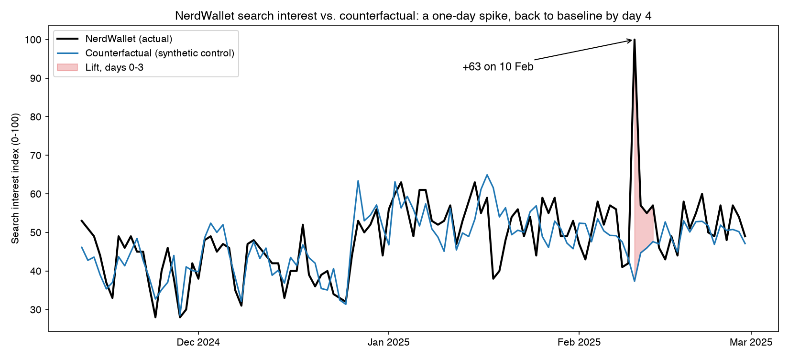
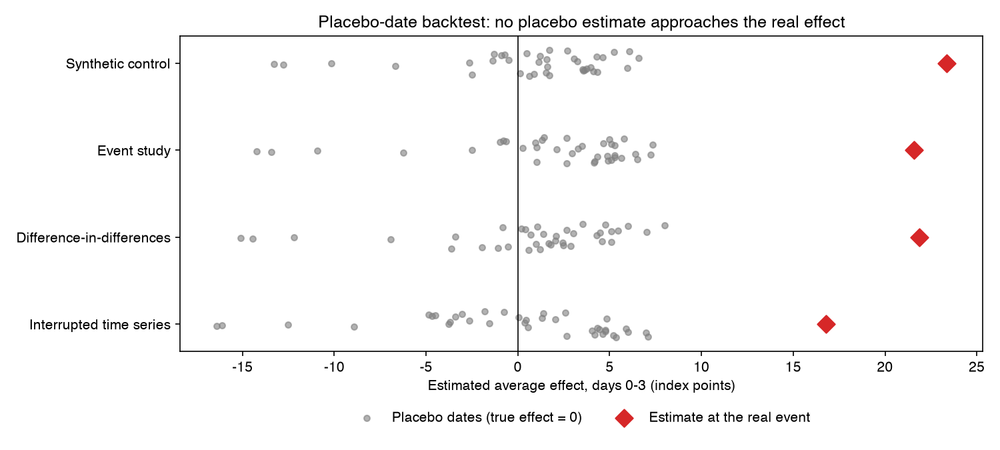
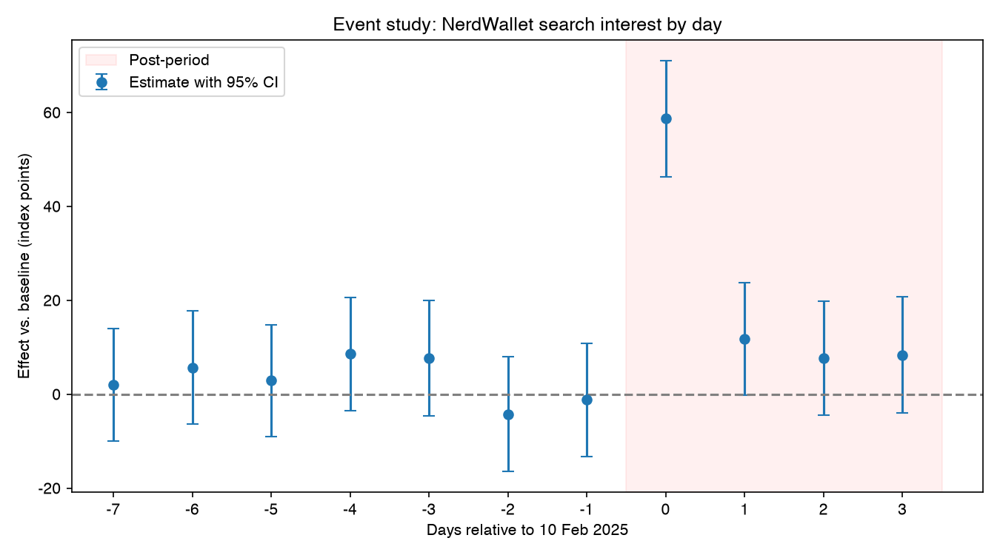

# Measuring the Search Lift from NerdWallet's 2025 Super Bowl Ad

How much did NerdWallet's Super Bowl LIX ad raise brand search interest, and for how long? This project estimates the lift from public Google Trends data with four causal inference methods. The preferred model is chosen by an out-of-sample placebo backtest, and its result is checked for robustness to the main researcher choices.



## Key results

| | Estimate |
|---|---|
| **Average lift, days 0–3** (10–13 Feb 2025) | **+23 index points** (placebo-based 95% interval: 17 to 36; empirical p = 0.026) |
| **Lift on day 0** (10 Feb) | **+63 index points**, about 2.7× the expected level (95% interval: 53 to 77) |
| **Duration** | Front-loaded: about two-thirds of the 4-day lift on day 0, then +12, +9 and +9 on days 1–3. Back near baseline from day 4 (+1.3 per day on average for the rest of February). |
| **Agreement across methods** | Synthetic control 23.3, DiD 21.9, event study 21.6; interrupted time series 13–17 |
| **Robustness** | 22.7–24.5 for every pre-period length from 30 to 100 days; 20.8–23.3 across five synthetic control specifications |

## Business context

A Super Bowl spot is one of the most expensive media buys available, and the measurable brand-demand lift is the starting point for valuing it. Because the ad aired nationally, there was no randomized holdout. The impact has to be inferred from observational data, by building a credible estimate of what NerdWallet search interest **would have been** without the ad.

The answer has two uses. It provides a brand-search baseline for valuing the spot, and its timing shows how paid search and follow-up activity should be scheduled around future tentpole campaigns.

## Data

Daily US [Google Trends](https://trends.google.com/trends/explore?date=2024-11-01%202025-02-28&geo=US&q=%2Fm%2F0hzpb7j,credit%20card%20points,travel%20credit%20card,best%20savings%20account&hl=en) data from 1 Nov 2024 to 28 Feb 2025 ([`google_trends.csv`](google_trends.csv)). The four series are indexed together from 0 to 100.

- **Treated series:** NerdWallet (Trends topic).
- **Control queries:** *credit card points*, *travel credit card* and *best savings account*. These personal-finance searches share the seasonal pattern of NerdWallet's audience, including a 10–15 point rise around the New Year, but have no direct reason to respond to a NerdWallet brand ad.

**Analysis window.** 90 days before the event (12 Nov – 9 Feb) and 4 days after it (days 0–3, 10–13 Feb). The pre-period covers the holiday season and the shared turn-of-year rise. The post-period is short because a single TV exposure produces an immediate, short-lived response, and the lift is back near baseline from day 4.

## Approach

| Method | Counterfactual | Validation | Days 0–3 effect |
|---|---|---|---|
| Interrupted time series | NerdWallet's pre-event trend, with and without control covariates | Out-of-sample forecast from a pre-period-only fit | 13.1–16.8 |
| Difference-in-differences (two-way fixed effects) | Pre-period gap to the equal-weighted control average, carried forward | No differential pre-trend (p = 0.77) | 21.9 |
| Event study | Level predicted from the controls; one indicator per day from −7 to +3 | No pre-event effects (joint p = 0.66) | 21.6 |
| **Synthetic control** | Weighted average of the controls (non-negative weights summing to one), shifted by its pre-period gap to NerdWallet | Pre-period RMSE 6.1; placebo-date backtest (in-space placebos too few to test) | **23.3** |

## Model selection

The selection metric is **out-of-sample error at placebo event dates**. The models were re-run on 38 dates before the ad (31 Dec – 6 Feb), where the true effect is zero, and each was scored on the RMSE of its placebo 4-day effects. The same test was used twice: first to choose the synthetic control specification, then to choose between the four methods.

**Synthetic control specification.** Five specifications were compared. All use the three control searches as donors and differ in how the weights and the level are fitted.

| Specification | Placebo RMSE | Placebo bias | In-sample pre-period RMSE | Days 0–3 effect |
|---|---|---|---|---|
| **Constrained weights, shifted by the pre-period gap ("netted")** | **4.69** | +0.74 | 6.09 | **23.3** |
| Constrained weights, no level shift (Abadie et al., 2010) | 4.99 | −2.00 | 6.59 | 20.8 |
| Constrained weights fitted on demeaned data | 5.30 | +0.20 | 6.04 | 22.6 |
| Lasso, `alpha = 0.1` | 5.41 | +1.46 | 5.76 | 21.5 |
| Lasso, cross-validated `alpha` | 5.67 | +1.96 | 5.76 | 21.3 |

The netted specification has the lowest out-of-sample error and ranks first under all three placebo designs tested, although the margins between the constrained specifications are small (0.3–0.6 points). The specification without a level shift comes closest, but it is biased downward by the pre-period level offset, which is known before the event. The Lasso fits have the best in-sample fit and the worst out-of-sample error, so their extra flexibility fits noise. The netted weights also stay interpretable: 54% *credit card points* and 46% *best savings account*, shifted by a constant.

**Choice of method.**

| Model | Placebo RMSE | Placebo bias | In-sample pre-period RMSE |
|---|---|---|---|
| **Synthetic control** | **4.69** | +0.74 | 6.09 |
| Difference-in-differences | 5.25 | +0.68 | 6.43 |
| Event study | 5.49 | +1.85 | 5.81 |
| Interrupted time series | 5.86 | −0.13 | 5.67 |



**The synthetic control is the preferred model.**

- **Lowest out-of-sample error.** Its placebo RMSE is 4.69, against 5.25 for DiD and 5.5–5.9 for the event study and ITS, with bias similar to DiD's and small relative to its RMSE. In-sample fit would have ranked it third, which shows why an out-of-sample test was needed.
- **Robust to the backtest design.** With 40-, 50- and 60-day placebo pre-periods it has the lowest RMSE of all methods and specifications every time (4.31, 4.52 and 4.69, against 4.59, 4.91 and 5.25 for DiD). The designs share most of their placebo dates, so this shows the ranking is not an artefact of the window length, but it does not remove the effect of selecting the specification on those dates.
- **Weights learned from the data, but still transparent.** DiD weights the three controls equally. The synthetic control learns that NerdWallet moves with *credit card points* and *best savings account* but not with *travel credit card*, and its counterfactual remains an average of real searches.

**How decisive the choice is.** The margin over DiD is modest (0.4–0.6 points of placebo RMSE), and with overlapping placebo windows the two are not statistically distinguishable. DiD is also more stable across pre-period lengths (a spread of 1.1 points, against 1.8), because its weights are fixed. The choice follows the pre-declared metric consistently, but it is a judgment between two good models. It matters little for the conclusion: DiD remains the main cross-check, and its estimate (21.9) is within 1.5 points of the synthetic control's.

**Inference.** The synthetic control has no conventional standard error, and conventional regression errors understate the uncertainty for a single treated series (for DiD, 3.6 against a placebo SD of 5.3). The reported interval and p-value come from the placebo distribution instead. None of the 38 placebo dates produced a synthetic control effect larger than 13.3 points in absolute value, against the real estimate of 23.3.

## Identification checks

A randomized experiment was not possible, because the ad aired nationally. The estimate instead compares NerdWallet with a weighted average of three personal-finance searches that follow the same seasonal pattern but had no reason to respond to a NerdWallet ad. Before the ad, this synthetic NerdWallet tracked the real one, including through the turn-of-year rise, and there was no unusual movement in the week before the broadcast. To test the method itself, I re-ran it on 38 dates when no ad aired. None of those runs produced an effect close to the one measured, and the same runs provide an empirical confidence interval that does not rely on textbook regression assumptions.

The result also holds when the modelling choices change. DiD, the daily event study and the synthetic control, which build the counterfactual directly from the control searches, give 21.6–23.3, five ways of fitting the synthetic control give 20.8–23.3, and the preferred estimate is stable across pre-period lengths. The main assumption that cannot be tested is that the ad did not change searches for the control terms. If it raised them, the lift is understated; if it lowered them, for example because viewers searched NerdWallet instead, the lift is overstated. The controls dip slightly on day 0, so the day-0 estimate may be on the high side: against NerdWallet's own 30-day average it is 48.5 points rather than 62.7.

| Check | Result |
|---|---|
| Pre-period fit (synthetic control) | RMSE 6.1, including the turn-of-year rise |
| Parallel pre-trends (DiD, same controls) | Differential trend −0.008 points per day, p = 0.77 |
| Anticipation (event study) | Days −7 to −1 jointly zero, p = 0.66 |
| Placebo-date backtest | 0 of 38 placebo effects as large as the real one |
| Pre-period length, 30–100 days | 22.7–24.5 |
| Alternative specifications | Other synthetic control specifications 20.8–22.6; DiD 21.9; single-indicator event study 20.6 |



## Limitations

- **Relative, sampled index.** Google Trends reports a relative index, not search volume. Values are sampled and rescaled for every query, so the index-point estimates apply to this export only.
- **Mixed series types.** NerdWallet is a Trends *topic*, while the controls are literal search terms.
- **Control dip on day 0.** The control average dips on day 0, mainly because *credit card points* falls. Measured against NerdWallet's own 30-day average instead, the day-0 lift is 48.5 points rather than 62.7.
- **Shared controls.** All control-based methods rely on the same three queries. Their agreement shows the result does not depend on how the controls are combined, but not that the controls were unaffected.
- **Overlapping placebo windows.** The 38 placebo windows overlap, so the placebo-based interval is approximate. The synthetic control specification was also chosen from five candidates on these dates, which the check across placebo designs only partly offsets.

## Implications

- **Day 0 carries most of the lift.** About two-thirds of the measurable lift arrives within roughly 24 hours of the broadcast. Paid-search budgets and caps, landing pages and site capacity should be sized for day 0 rather than spread across the following week.
- **The follow-up window is short.** The lift is back near baseline by day 4, so retargeting or follow-up activity has a window of a few days, not weeks.

## Next steps

- Translate the index lift into business value by mapping it to absolute search volume, site sessions and sign-ups for the same days.
- Measure future tentpole campaigns with a geo-holdout design for an experimental estimate, and expand the pool of control queries.

## Repository structure

```
├── ad_lift_causal_inference.ipynb   # Full analysis: models, backtest, inference, robustness
├── google_trends.csv                # Google Trends export (US, daily)
├── figures/                         # Charts generated by the notebook
├── pyproject.toml / uv.lock         # Pinned Python environment
└── README.md
```

## Reproducing the analysis

Requires Python 3.12+ and [uv](https://docs.astral.sh/uv/).

```bash
uv sync
uv run --with jupyter jupyter lab ad_lift_causal_inference.ipynb
```

Run all cells (or open the notebook in VS Code with the project's `.venv` kernel). The notebook regenerates every number and figure in this README.

**Stack:** pandas, statsmodels (OLS, two-way fixed effects, HAC standard errors), SciPy (synthetic control with constrained weights), scikit-learn (Lasso comparison specifications with time-series cross-validation), matplotlib.
